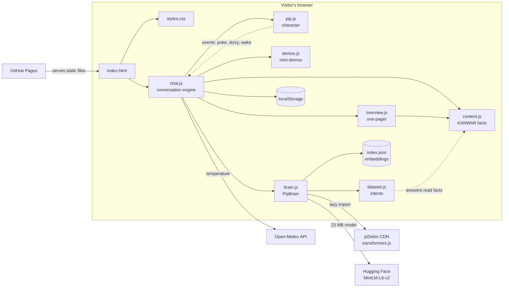
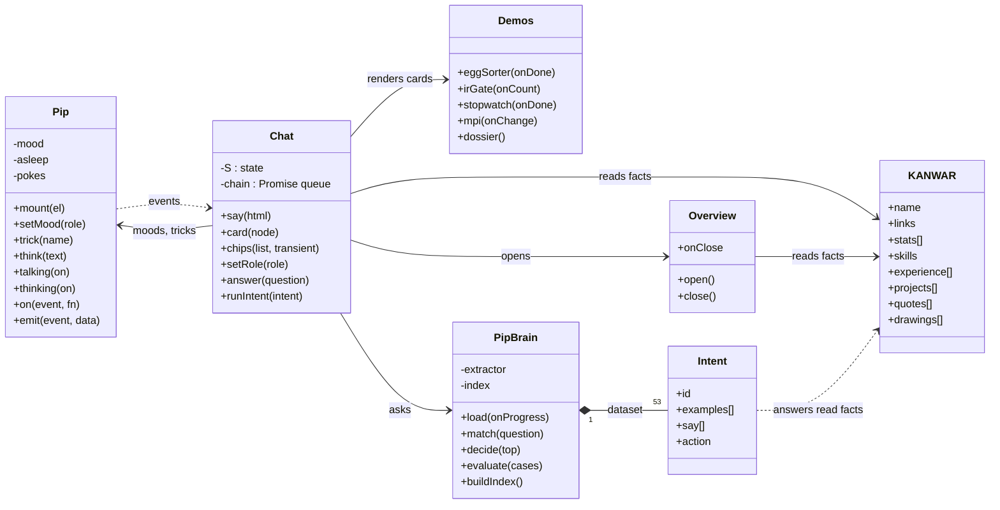
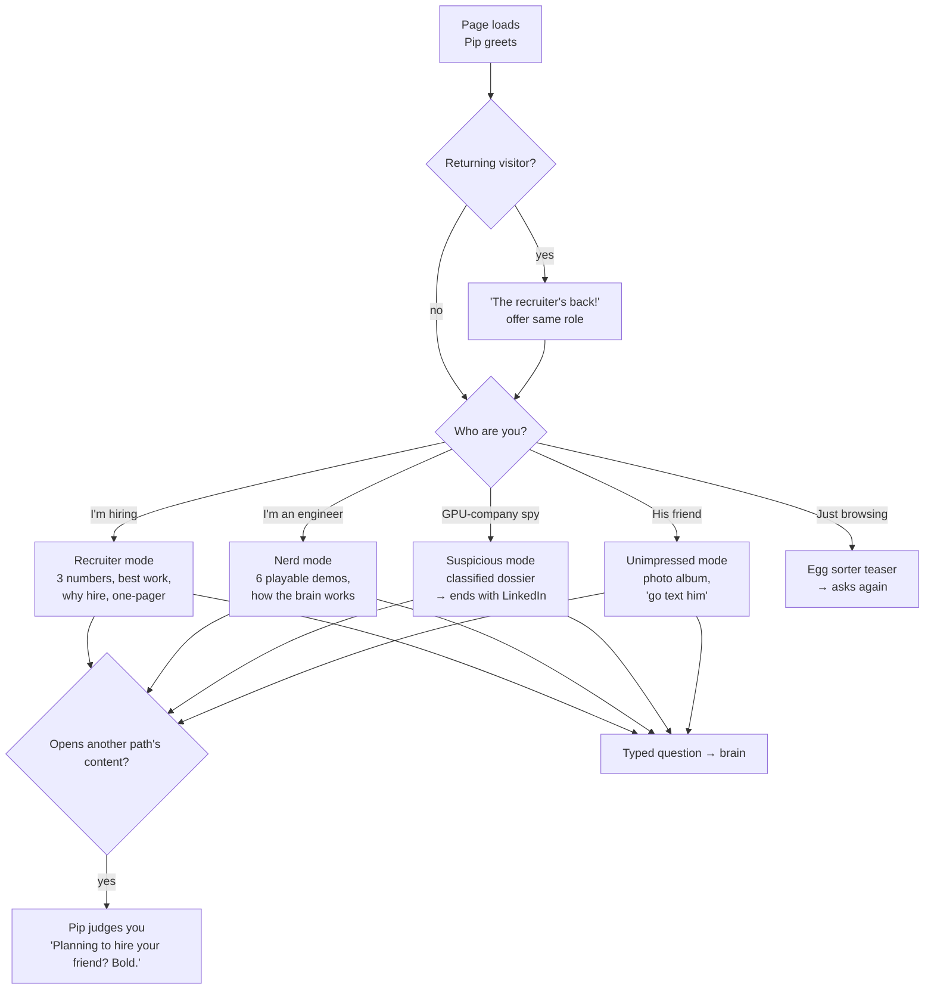
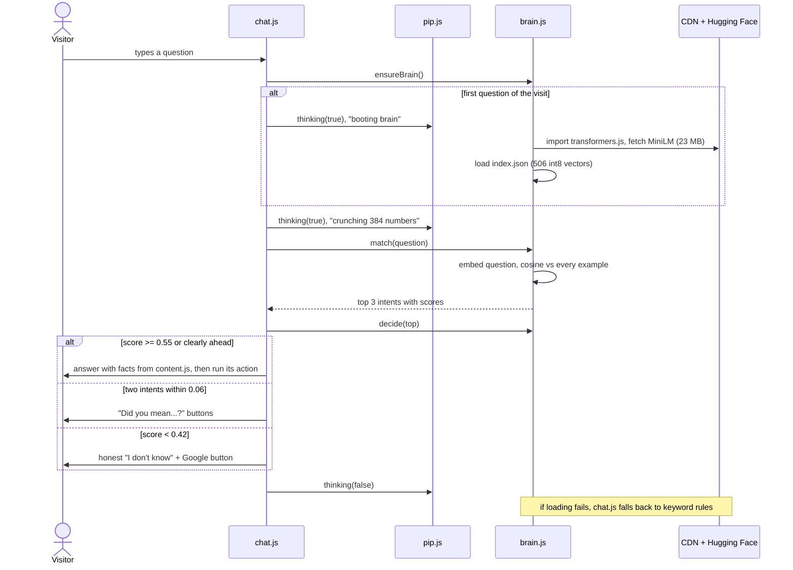
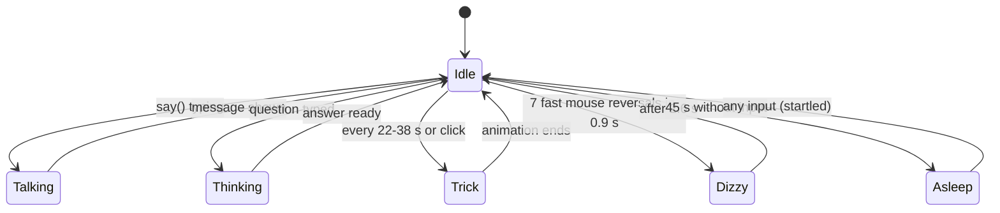
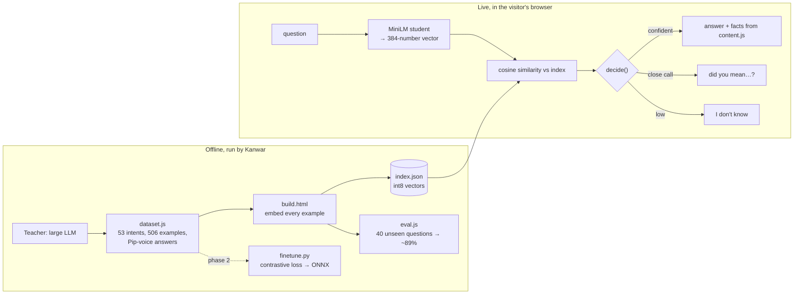

# Architecture

**lubanak.github.io** is a chat-first portfolio. Visitors meet **Pip**, an animated robot that asks who they are and shows each of them a different version of the site. It's a static site with no backend: everything runs in the visitor's browser, including a small neural network that answers typed questions.

| | |
|---|---|
| Code | ~2,640 lines across 13 files |
| Frameworks / build step / server | none |
| Visitor paths | 4 (recruiter, engineer, "spy", friend), plus "just browsing" |
| Language model | MiniLM-L6-v2, 23 MB, 8-bit, runs on-device |
| Held-out eval | ~89% on 40 unseen questions |

---

## Tech stack

| Technology | Layer | Used for |
|---|---|---|
| **HTML5** | Structure | One page: top bar, Pip's stage, chat log, quick-reply buttons, text box. ARIA live region for the chat. |
| **CSS3** | Presentation | Design tokens (custom properties), Grid and Flexbox, `@keyframes` for all of Pip's tricks, responsive at 860px, `prefers-reduced-motion`. |
| **JavaScript (ES2020+)** | Behaviour | Vanilla, no framework. Each file is an IIFE module exposing one global (`Pip`, `Demos`, `Overview`, `PipBrain`). `async/await`, a promise queue for messages, Pointer Events, `requestAnimationFrame`. |
| **SVG** | Graphics | Pip is drawn in code, with swappable parts for moods (tie, glasses, sunglasses, sleepy and dizzy eyes). |
| **transformers.js 3.8.1** | Machine learning | Runs the model in the browser on ONNX Runtime Web (WebAssembly). Loaded from jsDelivr only when someone starts typing. |
| **MiniLM-L6-v2 (q8)** | Machine learning | Sentence-embedding model: question → 384-number vector. |
| **Web Storage** | State | `localStorage` remembers role, visit count and demo counters. |
| **Open-Meteo API** | Data | Live Winnipeg temperature (free, no key, fails silently). |
| **Python 3** | Tooling | `brain/build_server.py` saves the embedding index; `brain/finetune.py` handles phase-2 fine-tuning. |
| **Git + GitHub Pages** | Hosting | Static hosting from `main`. Features built on branches and merged. |

---

## Page layout

```
desktop (grid: 400px stage | 1fr chat, height 100dvh)
┌──────────────────────────────────────────────────────────────────────┐
│ ◉ Kanwar Lubana · open to co-op        [LinkedIn] [GitHub] [See all] │  .top
├──────────────────────┬───────────────────────────────────────────────┤
│                      │  Pip: Hi! Who are you?                        │  .log (scrolls)
│       ┌──────┐       │                          [ I'm hiring ]       │
│       │ ◉  ◉ │ Pip   │  ┌─ rich card: stats / project / demo ─┐      │
│       └──────┘       │  └──────────────────────────────────────┘      │
│  thought bubble      │  ( Best work ) ( Why hire? ) ( One-pager )    │  .chips
│  Winnipeg: -18°C     │  [ Ask Pip anything…                    ↑ ]   │  #composer
│      .stage          │                 .chatcol                      │
└──────────────────────┴───────────────────────────────────────────────┘
phone: the stage becomes a 170px band above the chat. "See everything" opens a full-screen overlay (#overview).
```

---

## File structure

```
site/
├── index.html            page shell + shared SVG gradients                   82
├── styles.css            tokens, layout, Pip animations, cards               320
├── js/
│   ├── content.js        ALL facts about Kanwar (single source of truth)     160
│   ├── pip.js            the character: SVG, moods, tricks, events          267
│   ├── demos.js          egg sorter, IR gate, stopwatch, MPI, dossier       224
│   ├── overview.js       "See everything" one-page summary                    91
│   └── chat.js           conversation engine, 4 paths, brain wiring         666
├── brain/
│   ├── dataset.js        53 intents · 506 example questions · answers       400
│   ├── brain.js          model loading, embedding, matching, decide()        178
│   ├── index.json        precomputed int8 embeddings (~250 KB)
│   ├── eval.js           40 held-out test questions                           48
│   ├── build.html        rebuild index + run eval                             58
│   ├── build_server.py   local server that saves the index                    59
│   └── finetune.py       phase 2: contrastive fine-tune → ONNX                89
└── img/                  project photos
```

Scripts load in dependency order: `content → pip → demos → overview → dataset → brain → chat`.

---

## Components



---

## UML: classes and modules

There are no ES classes. Each file is a module object with private state in a closure. Here each module is drawn as a class: `-` marks private state, `+` marks public methods.



---

## Conversation flow



---

## UML: sequence for a typed question



---

## UML: Pip's states

Pip's body runs on CSS classes that JavaScript toggles. Moods (tie, glasses, sunglasses, half-closed eyes) sit on top of any state.



---

## The brain pipeline (knowledge distillation)



- **Facts are looked up, never memorized.** Answers are templates that read `content.js`, so they're always correct, and updating the resume never needs retraining.
- **Int8 index.** 506 × 384 vectors are stored as 8-bit and base64 (~250 KB instead of ~2 MB). Visitors only embed their own question.
- **Confidence rules.** Answer at ≥ 0.55 or with a 0.06 lead, ask "did you mean" in between, admit not knowing below 0.42.
- **Measured.** The held-out eval re-runs on every rebuild. The first 30 test questions also guided which examples to add, so ~89% is slightly optimistic; the 10 newest are the clean check.

See [brain/README.md](brain/README.md) for how to retrain.

---

## Design decisions and trade-offs

| Decision | Why | Trade-off |
|---|---|---|
| Static site, no backend | Free hosting, nothing to maintain or attack | No shared data: demo counters are per visitor, and logging questions needs an outside service |
| Small on-device model, not an LLM API | No key to leak, no cost per question, private, can't invent facts | Picks from known answers instead of writing new ones; 23 MB first download |
| Lazy load + keyword fallback | The page stays fast; still works if the model can't load | First typed question waits a few seconds (covered by a "booting brain" animation) |
| One promise queue for all messages | Pip never talks over itself when buttons, questions and events arrive together | Messages are strictly sequential |
| `content.js` as single source of truth | Chat, one-pager and brain answers always agree | All content in one file |
| No framework | Tiny, fast, every line readable | State and rendering managed by hand; a framework would pay off at a larger size |
| Accessibility | ARIA live chat, keyboard-usable demos, visible focus, reduced motion | — |
| Privacy | No phone number, no internal screenshots without permission, no analytics, questions stay on-device | — |
